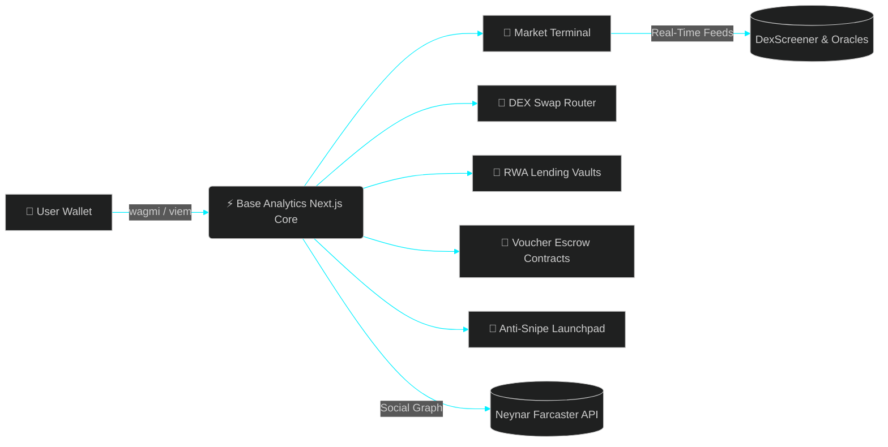

<!-- ================= CYBER-ANIME 3D LAYERED HEADER ================= -->

<!-- ================= DYNAMIC PRODUCT TICKER ================= -->

  

<!-- ================= 3D KEYCAP COMMAND DECK ================= -->
<kbd> <a href="https://github.com/Surya512002/base-analytics-app"><b>🚀 Launch Base Analytics</b></a> </kbd> 
<kbd> <a href="https://x.com/TamilCrypt0"><b>𝕏 @TamilCrypt0</b></a> </kbd> 
<kbd> <a href="https://farcaster.xyz/suryaprakash"><b>🟣 Farcaster</b></a> </kbd> 
<kbd> <a href="https://www.linkedin.com/in/surya-prakash-7564a6255"><b>💼 LinkedIn</b></a> </kbd>

 

<!-- ================= 01. STUDIO OVERVIEW & LIVE PIPELINE ================= -->
<table width="100%">
  <tr>
    <td width="58%" valign="top">
      <h3>⚡ Engineering Consumer-Grade Web3</h3>
      

        I design and ship end-to-end onchain applications—from Solidity smart contracts to high-speed Next.js interfaces. My focus is turning complex decentralized finance primitives (DEX swaps, tokenized stocks, onchain vouchers, and token launchpads) into clean, intuitive products that anyone can use effortlessly.
      

      

        <kbd><b>Next.js</b></kbd> <kbd><b>React</b></kbd> <kbd><b>TypeScript</b></kbd> <kbd><b>Solidity</b></kbd> <kbd><b>Go</b></kbd> <kbd><b>Tailwind CSS</b></kbd> <kbd><b>wagmi / viem</b></kbd>
      

    </td>
    <td width="42%" valign="top">
      <h3>🛰️ Live Product Pipeline</h3>
      <table>
        <tr>
          <td><b>Product</b></td>
          <td><b>Progress</b></td>
          <td><b>Status</b></td>
        </tr>
        <tr>
          <td><a href="https://github.com/Surya512002/base-analytics-app"><b>Base Analytics</b></a></td>
          <td><code>▰▰▰▰▰▰▰▰▰▰</code></td>
          <td>🟢 <b>LIVE</b></td>
        </tr>
        <tr>
          <td><b>Banner Studio</b></td>
          <td><code>▰▰▰▰▰▰▰▰▰▰</code></td>
          <td>🟢 <b>LIVE</b></td>
        </tr>
        <tr>
          <td><b>Stock Vouchers</b></td>
          <td><code>▰▰▰▰▰▰▰▰▱▱</code></td>
          <td>🟣 <b>BUILDING</b></td>
        </tr>
        <tr>
          <td><b>USDC Vouchers</b></td>
          <td><code>▰▰▰▰▰▰▰▰▱▱</code></td>
          <td>🔵 <b>BUILDING</b></td>
        </tr>
      </table>
    </td>
  </tr>
</table>

<!-- ================= 02. FLAGSHIP PRODUCT: BASE ANALYTICS ================= -->

  <h2>🔵 Flagship App // <a href="https://github.com/Surya512002/base-analytics-app">Base Analytics</a></h2>
  
<i>All-in-one market intelligence terminal, DEX trading hub, RWA lending protocol, and launchpad.</i>

<table width="100%">
  <tr>
    <td width="33%" valign="top">
      <kbd><b>🧭 01 // EXPLORE TERMINAL</b></kbd>
      

      <ul>
        <li>Real-time token market tracking</li>
        <li>Trending gainers & new launches</li>
        <li>Instant <code>⌘K</code> global command search</li>
        <li>Custom portfolio watchlists</li>
      </ul>
    </td>
    <td width="33%" valign="top">
      <kbd><b>🔁 02 // DEX SWAP ENGINE</b></kbd>
      

      <ul>
        <li>Zero-clutter swap execution</li>
        <li>Live wallet holdings breakdown</li>
        <li>Custom slippage & price-impact guard</li>
        <li>Transparent fee routing</li>
      </ul>
    </td>
    <td width="33%" valign="top">
      <kbd><b>🏦 03 // RWA LEND & STAKE</b></kbd>
      

      <ul>
        <li>Tokenized stocks (RWA) hub</li>
        <li>Isolated lending & borrow markets</li>
        <li>Yield staking pools & gauges</li>
        <li>Real-time APY & collateral health</li>
      </ul>
    </td>
  </tr>
  <tr>
    <td width="33%" valign="top">
      <kbd><b>🎁 04 // ONCHAIN VOUCHERS</b></kbd>
      

      <ul>
        <li>Cryptographic onchain gift cards</li>
        <li>Supports USDC, ETH & RWA stocks</li>
        <li>Yield-bearing voucher vaults</li>
        <li>One-click claim & redemption flow</li>
      </ul>
    </td>
    <td width="33%" valign="top">
      <kbd><b>🚀 05 // TOKEN LAUNCHPAD</b></kbd>
      

      <ul>
        <li>Deploy vanity ERC-20 & meme tokens</li>
        <li>Stock-paired memestock launches</li>
        <li>Built-in anti-snipe protection</li>
        <li>Automated liquidity locking</li>
      </ul>
    </td>
    <td width="33%" valign="top">
      <kbd><b>👤 06 // CREATOR IDENTITY</b></kbd>
      

      <ul>
        <li>Unified creator profile & analytics</li>
        <li>Daily onchain GM/GN check-in streaks</li>
        <li>Automated creator revenue sharing</li>
        <li>Token lockups & vesting schedules</li>
      </ul>
    </td>
  </tr>
</table>

<!-- INTERACTIVE ARCHITECTURE DRAWER (RENDERED NATIVELY BY GITHUB) -->

  
<kbd><b>📐 CLICK TO EXPAND // BASE ANALYTICS SYSTEM ARCHITECTURE</b></kbd>

   

 

<!-- ================= 03. PRODUCT SUITE & R&D LABS ================= -->

  <h2>🧪 Product Suite & Active Builds</h2>

<table width="100%">
  <tr>
    <td width="33%" valign="top">
      <kbd><b>🎟️ Stock Vouchers on Base</b></kbd>
        
      
      

        An evolution of the ETH/USDC voucher protocol that lets users wrap real tokenized stocks into shareable onchain gift cards—enabling anyone to gift fractional equity via a simple claim link.
      

    </td>
    <td width="33%" valign="top">
      <kbd><b>💵 USDC Gift Vouchers</b></kbd>
        
      
      

        Non-custodial USDC gifting protocol built with Arc Studio. Lock USDC in a smart contract, send a claim link to any recipient, and allow instant wallet redemption without complex onboarding.
      

    </td>
    <td width="33%" valign="top">
      <kbd><b>🎨 Community Banner Studio</b></kbd>
        
      
      

        Self-contained graphic studio for generating personalized 1500×500 X/Twitter banners. Features custom avatar uploads, a 250-country flag selector, live HTML5 canvas preview, and instant PNG export.
      

    </td>
  </tr>
</table>

<!-- ================= 04. FULL-STACK ARSENAL ================= -->

  <h2>🛠️ Engineering Arsenal</h2>
   
  
    

<table width="100%">
  <tr>
    <td width="25%" align="center" valign="top">
      <kbd><b>FRONTEND SYSTEMS</b></kbd>  
      Next.js · React TypeScript · Tailwind CSS shadcn/ui · BaseUI
    </td>
    <td width="25%" align="center" valign="top">
      <kbd><b>WEB3 & CONTRACTS</b></kbd>  
      Solidity · wagmi / viem ERC-20 · RWA Vaults DEX & Escrow Routers
    </td>
    <td width="25%" align="center" valign="top">
      <kbd><b>DATA & INDEXING</b></kbd>  
      Neynar (Farcaster API) DexScreener Feeds Chainlink Oracles
    </td>
    <td width="25%" align="center" valign="top">
      <kbd><b>BACKEND & OPS</b></kbd>  
      Go · Node.js Smart Contract Testing Git · Vercel CI/CD
    </td>
  </tr>
</table>

<!-- ================= 05. TELEMETRY COCKPIT ================= -->

  <h2>📊 Live Builder Telemetry</h2>
   

  <!-- Full-Width Cyber Neon Contribution Wave -->
  

    

  <!-- 3-Column Single-Row HUD Cards -->
  
  
  

    

  <!-- Contribution Snake -->
  <picture>
    <source media="(prefers-color-scheme: dark)" srcset="https://raw.githubusercontent.com/Surya512002/Surya512002/output/github-contribution-grid-snake-dark.svg">
    <source media="(prefers-color-scheme: light)" srcset="https://raw.githubusercontent.com/Surya512002/Surya512002/output/github-contribution-grid-snake.svg">
    
  </picture>

    

  

  

